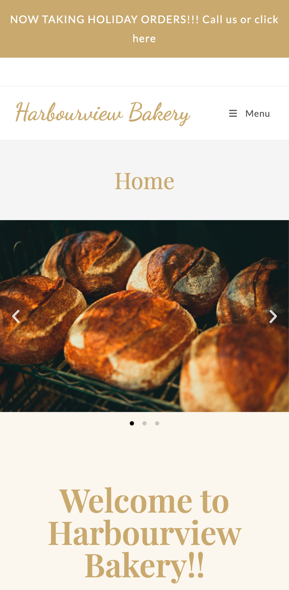
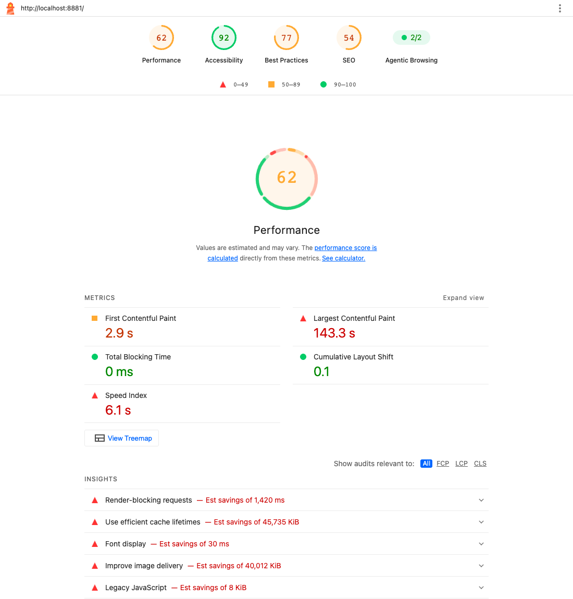
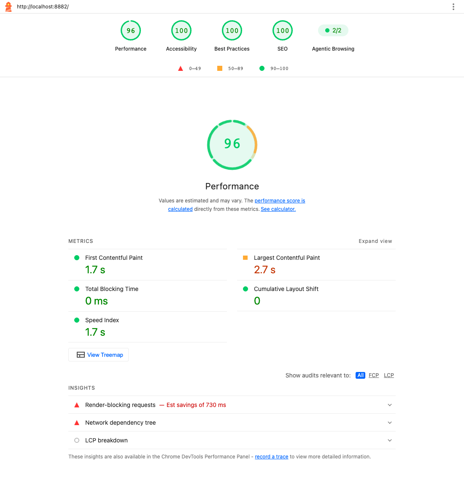
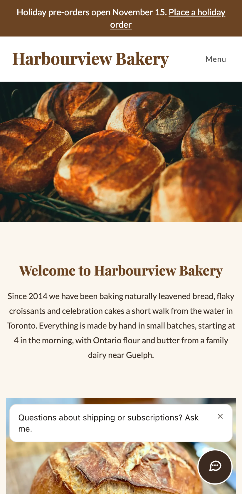
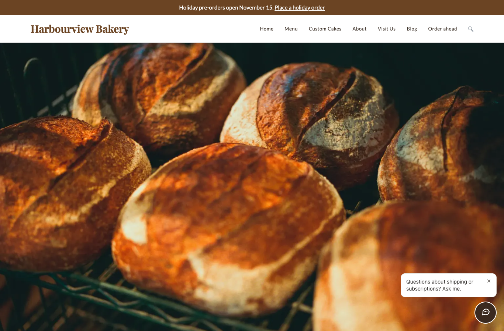
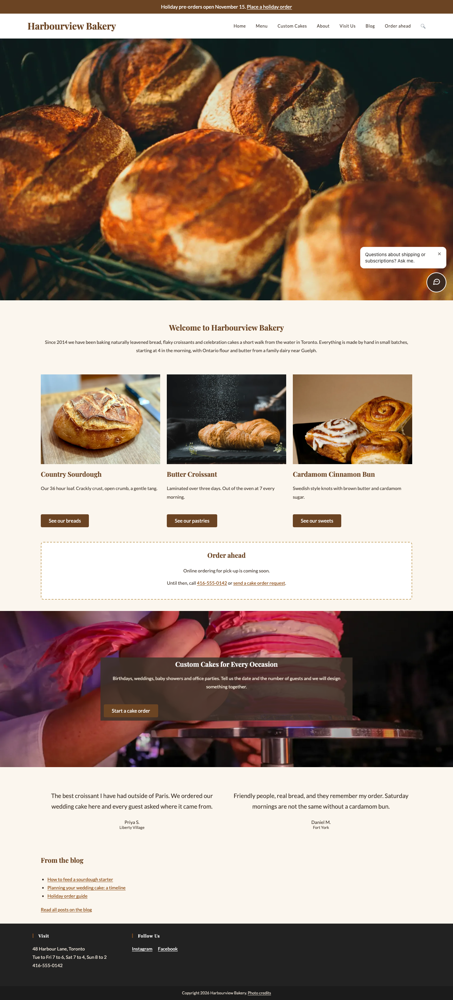

# Case study: rescuing a slow bakery website without rebuilding it

*Harbourview Bakery is a fictional business. The site, its problems and the
fixes are real WordPress, real free plugins and real measurements, rebuilt
from scripts in this repo so anyone can check the work. The photos are real
bakery photos from Unsplash, credited in [CREDITS.md](CREDITS.md).*

## The situation

Harbourview Bakery is a busy neighbourhood bakery in Toronto. Their website
was built a few years ago by a freelancer who has since moved on. Since then
the owner has added photos straight from her phone, installed a few plugins
that "might be useful", and pasted in a holiday banner.

What she told me:

- "The site feels slow on my phone, especially the home page."
- "Nobody has used the cake order form in months." (It turned out the form
  had been failing silently. Customers saw an error and gave up.)
- "We don't show up on Google when people search for us."
- "I'd like a chat button and online ordering, but I can't afford a new
  website."

She did not want a redesign. She wanted the site she has, working properly.

## What I found

| On a phone, at first | Three seconds later |
|----------------------|---------------------|
|  |  |

**Speed**
- The home page downloaded **47.0 MB** on every visit. Almost all of
  it was photos: three camera photos 6000 to 6800 pixels wide in an
  auto-playing slider, and a 6700 pixel photo re-saved as a 23.5 MB PNG and
  used as a background. A phone screen is about 400 pixels wide.
- A setting in the old theme had switched off WordPress' automatic
  downscaling of large uploads, and another had switched off lazy loading
  "because it broke the slider".
- **8 active plugins**, most of them loading their files on every page,
  whether the page used them or not: a page builder add-on pack with no
  widgets in use, a popup plugin, a social icons plugin, a slider plugin that
  was never used, a second copy of Font Awesome from a CDN, and a code
  snippets plugin with no snippets.
- **Seven font families** (Playfair Display, Lato, Dancing Script, Open
  Sans, Montserrat, Roboto, Roboto Slab) in every weight, loaded from Google,
  plus two icon fonts.
- jQuery and a custom script in the page head, blocking the first paint.
- No page caching and no browser caching rules.

**Things moving around (layout shift)**
- A holiday banner was injected by a script a second after the page loaded,
  pushing everything down just as the visitor started reading.
- Blog photos were pasted in without dimensions, so text jumped when they
  arrived.

**Google and sharing**
- "Discourage search engines" was still switched on from when the site was
  built. Every page told Google not to index it, and there was no sitemap.
- Every page had the same title: "Harbourview Bakery | Best Bakery in Toronto
  | Cakes, Bread, Pastries".
- No meta descriptions, no structured data (Google did not know it was a
  bakery, where it is, or when it is open), and no alt text on any image.

**The contact form**
- The cake order form tried to send email through the web server, which this
  host does not allow, and pretended to send from a gmail.com address.
  Every submission failed with "There was an error trying to send your
  message".

**Accessibility**
- Light gold text on cream: unreadable for many people and in sunlight.
- Form fields with placeholder text and no labels.
- Focus outlines removed, so keyboard users could not see where they were.
- No H1 on most pages, headings out of order, and "Click here" as the text of buttons and links.
- A newsletter popup that opened on every page after three seconds.

## What I changed, and why

Everything below was done **on the existing site**. Same theme (OceanWP),
same page builder (Elementor), same pages. The owner keeps editing the site
exactly the way she did before.

| Change | Why it matters |
|--------|----------------|
| Removed 6 unused plugins and 2 inactive leftovers | Fewer files on every page, fewer things to update and secure |
| Turned on the theme's own performance switches (SVG icons instead of icon fonts, no lightbox, no scroll effects) | The theme could already do this; nobody had flipped the switches |
| Slider replaced by one hero photo, loaded first | The first photo is what visitors see; three rotating photos cost three downloads and hurt sales more often than they help |
| Every photo cropped to the shape it is shown in, scaled to at most 2560 px, converted to WebP, with smaller versions for phones | Phones download a photo sized for a phone, and rows of photos line up |
| Lazy loading back on for photos below the fold | Photos further down load only when the visitor scrolls to them |
| Two font families, three files, hosted on the site, shown immediately | Text appears right away in the right font; seven families became two |
| jQuery moved out of the page head, jQuery Migrate and emoji scripts removed, contact form files only on the form page | The page can draw before scripts run |
| Page cache (Cache Enabler, free) and browser caching rules | Pages are served as ready-made files; returning visitors reuse files they already have |
| Holiday banner built into the page instead of injected by a script | Same message, nothing jumps |
| Search engines allowed in, XML sitemap on | Google can find and list the site |
| A real title and description for every page; Bakery structured data with address, hours and menu link; Open Graph tags for sharing | Better search listings and better links when shared on social media |
| Alt text on every photo, one H1 per page, headings in order, descriptive buttons | Works for screen readers and helps Google understand each page |
| Readable colours (all text now passes WCAG AA), visible keyboard focus | Readable on a phone in the sun, usable without a mouse |
| Form: proper labels, email sent through an SMTP mail service, from the bakery's own address, with Reply-To set to the customer | The form works, and staff can answer a request with one click |
| Newsletter popup removed | There was no newsletter behind it |

All of it is code in this repo: a cleaned-up child theme, five small
must-use plugins, and two scripts. The full list of steps is
[after/rescue.sh](after/rescue.sh).

## The numbers

Measured with Lighthouse 13.6.0 on the same laptop, same Chrome,
same pages, BEFORE and AFTER runs interleaved. Three runs per page and device;
the table shows the median. Mobile uses Lighthouse's standard simulated slow
4G connection and slower CPU.

| Page | Device | Performance score | Largest Contentful Paint | Layout shift (CLS) | Page weight | Requests | Accessibility | SEO | Best practices |
|---|---|---|---|---|---|---|---|---|---|
| Home | Mobile | 62 → **96** | 143.3 s → **2.7 s** | 0.10 → **0.00** | 47.0 MB → **567 KB** | 80 → **34** | 92 → **100** | 54 → **69\*** | 77 → **100** |
| Home | Desktop | 49 → **99** | 18.9 s → **0.8 s** | 0.04 → **0.00** | 47.3 MB → **490 KB** | 81 → **35** | 92 → **100** | 54 → **69\*** | 77 → **100** |
| Menu | Mobile | 69 → **92** | 6.4 s → **3.2 s** | 0.10 → **0.03** | 2.3 MB → **484 KB** | 73 → **31** | 92 → **100** | 54 → **69\*** | 77 → **100** |
| Menu | Desktop | 97 → **100** | 1.2 s → **0.6 s** | 0.04 → **0.00** | 7.3 MB → **484 KB** | 72 → **31** | 92 → **100** | 54 → **69\*** | 77 → **100** |
| Blog post | Mobile | 85 → **96** | 3.5 s → **2.6 s** | 0.10 → **0.00** | 3.6 MB → **285 KB** | 54 → **19** | 90 → **100** | 46 → **69\*** | 77 → **100** |
| Blog post | Desktop | 98 → **100** | 1.0 s → **0.7 s** | 0.04 → **0.00** | 3.8 MB → **343 KB** | 54 → **20** | 90 → **100** | 46 → **69\*** | 77 → **100** |

\* Every SEO check passes except "page is blocked from indexing": this demo copy has `noindex` on purpose, so a
fictional bakery never shows up on Google. On a real job the site is open to search engines (the rescue switches
indexing back on), and with that one check passing these pages scored 100.

Measured on November 9, 2026, after a design refresh of the Home, Menu, Custom Cakes and About pages (same theme,
same page builder, see `after/scripts/redesign.php`). The refreshed home page has more photos and sections, so it is
a little heavier than the first "after" (567 KB instead of 456 KB) and scores the same.

| | Before | After |
|-|--------|-------|
| Active plugins | 8 | 3 (plus 5 small must-use plugins in the repo) |
| Font families | 7 (plus 2 icon fonts) | 2 |
| Full-size photo files the site serves | 86.2 MB | 6.8 MB (the camera originals stay on the server as a backup) |
| Cake order form | fails every time | delivers, checked by `make verify-form` |
| Indexable by Google | no (noindex, no sitemap) | yes, with sitemap |

The hosted demo copies of both sites are set to noindex because the bakery is
fictional. The AFTER numbers above were measured with indexing on, as it would
be for a real client.

| Lighthouse, home page, mobile: before | After |
|---------------------------------------|-------|
|  |  |

| The home page after, on a phone | On a desktop |
|---------------------------------|--------------|
|  |  |

Full reports: [reports/SUMMARY.md](reports/SUMMARY.md), every run's JSON in
[reports/lighthouse/raw](reports/lighthouse/raw), and the HTML report for each
median run in [reports/lighthouse/html](reports/lighthouse/html).

### How to read these numbers honestly

- **These are lab numbers, not real visitors.** Both sites run on my laptop,
  so there is no real network distance and the server is never busy.
  Lighthouse simulates a slow phone connection, which is useful for comparing
  before and after, but real visitors on a real host will see different
  absolute numbers. Real-user data (Google's Chrome UX Report, or the host's
  analytics) needs two to four weeks of traffic after the change, and is what
  I would report back to a client.
- **The 143 second LCP before is a simulation.** It is Lighthouse's estimate
  of downloading 47 MB over a slow 4G connection. On good Wi-Fi the old home
  page appeared much faster than that; on a phone with a weak signal it
  really was close to unusable.
- **Total blocking time is 0 ms everywhere** (median of three runs). My
  laptop is fast and the page scripts are small. Only one run of the old home
  page on desktop showed any (157 ms), while the browser was busy decoding
  47 MB of photos. On a mid-range phone the removed scripts (about half the
  JavaScript on the home page) would also make a visible difference, but
  this lab test cannot show script cost on its own.
- **The photos are real photos**, free stock photos from Unsplash, uploaded
  at their original size (2300 to 6800 pixels wide, 0.7 to 9 MB each) the way
  an owner uploads camera files, and two of them re-saved as PNG. So the image
  savings are what a real site with these uploads would see. This home page is
  on the heavy side: with ordinary phone photos a home page like this is more
  often 10 to 30 MB before the fix. On a phone the after home page
  loads 181 KB of photos: right-sized WebP files, with the photos further
  down the page loaded only when the visitor scrolls to them.
- **The before site already had some help from WordPress.** WordPress adds
  responsive image sizes to images placed with its own tools, which is why
  the menu page was not as heavy as the home page. The slider, the background
  photo and the pasted blog images bypassed that.
- **The after site includes the new chat widget** (about 10 KB of script,
  loaded with `defer`). It is part of what the client asked for, so it is
  in the numbers.

## What was added without rebuilding

**A support chat button.** One script tag, added by a small must-use plugin,
loaded after the page so it does not slow anything down. For this demo it
uses an existing sample bot ("northwind") from my docs-chat project, which
answers questions about a different company. On a real job the bakery gets
its own bot, built from its menu, hours, cake ordering FAQ, allergy
information and policies, and the only change on the website is the bot name
in that script tag.

**A spot for online ordering.** An "Order ahead" box on the home page and the
Custom Cakes page, and an "Order ahead" link in the menu. For now it shows the
phone number and a link to the cake form. When the bakery is ready for online
ordering, an embeddable ordering widget goes into that box: one line of code,
no redesign.



## Cost and time

This is what I would quote for a site like this one.

| Item | Time | Price (CAD) |
|------|------|-------------|
| Audit: measurements, list of problems, plan | 0.5 day | 400 |
| Speed and clean-up (plugins, images, fonts, scripts, caching) | 1.5 days | 1,200 |
| Google basics (indexing, titles, descriptions, structured data, alt text) | 0.5 day | 400 |
| Contact form fix with a proper mail service | 0.25 day | 200 |
| Accessibility fixes (contrast, labels, headings, focus) | 0.5 day | 400 |
| Support chat set up with the bakery's own content | 0.5 day | 400 + hosting from 10 per month |
| Online ordering widget, once available | 0.5 day | 400 |
| **Rescue total (first five rows)** | **about 3.5 days** | **2,600** |

Fixed price, agreed after the audit. The audit fee is credited if the client
goes ahead. All work is done on a staging copy first and applied to the live
site in a quiet hour, with a backup taken just before. A rebuild of the same
site would typically cost 3 to 5 times as much and take weeks, and the owner
would have to learn a new editor.

## Reproduce it

```bash
make before && make after   # both sites from the same seed
make verify-form            # the form fails BEFORE and works AFTER
make measure                # Lighthouse, 3 runs each, median
```

Details in [README.md](README.md).
