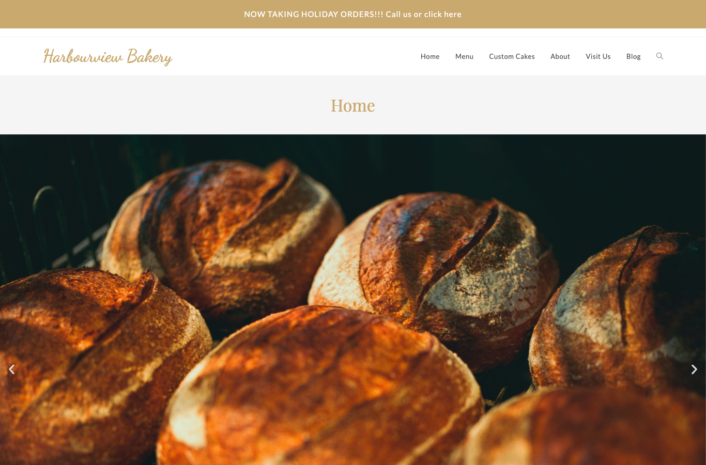
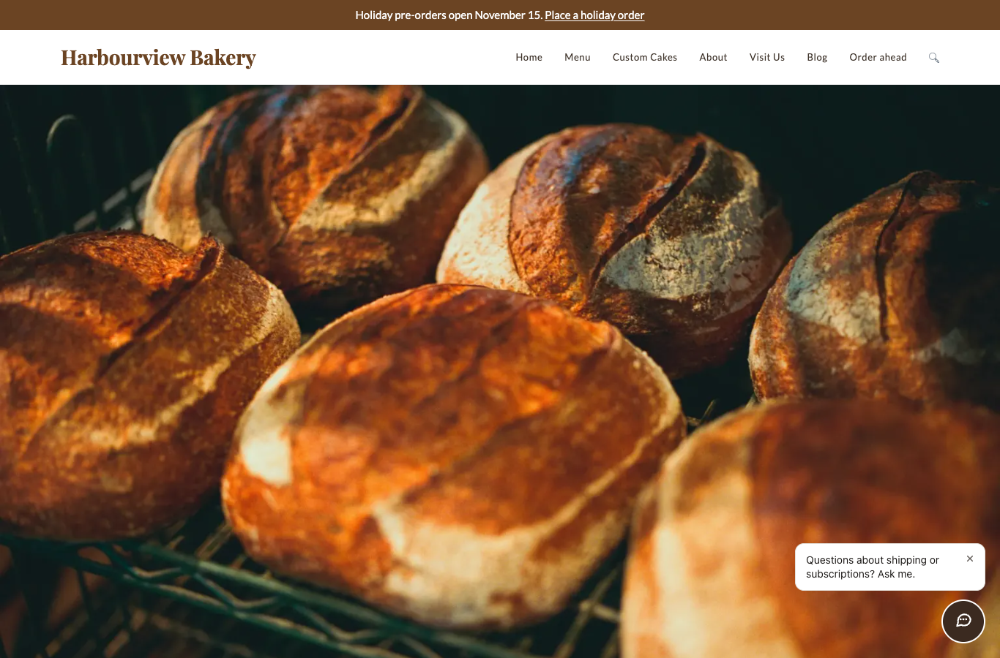
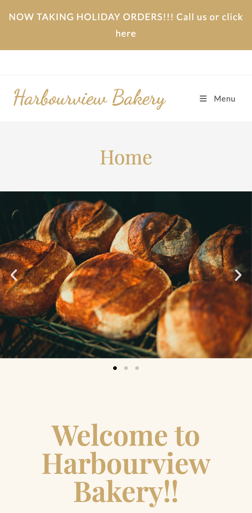
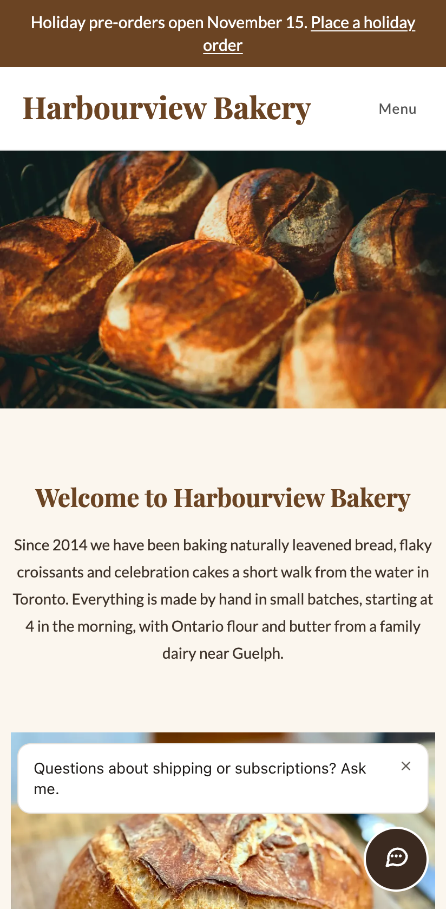
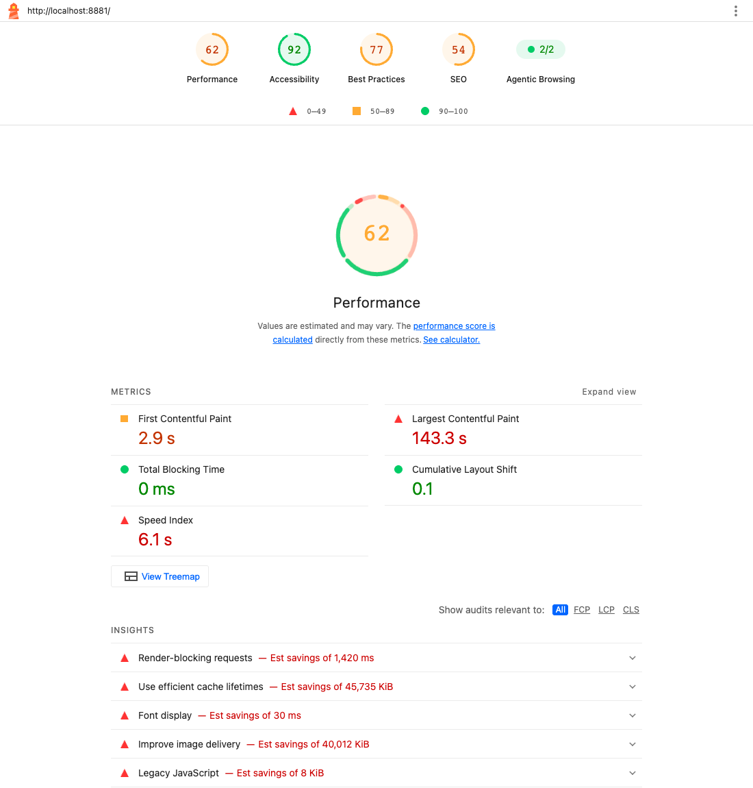
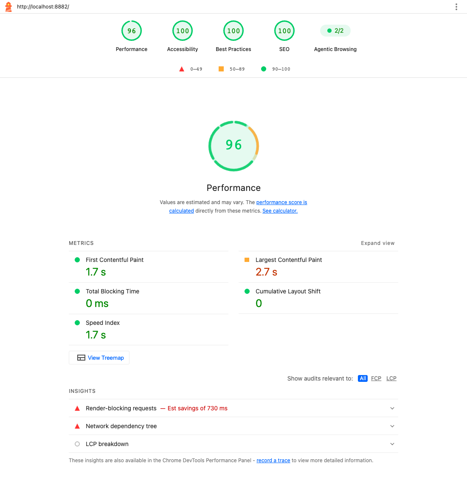

# site-rescue

**Fix and speed up the website you already have, without starting over.**
A reproducible before/after rescue of a slow, messy small-business WordPress
site, measured with Lighthouse, plus new features added without a rebuild.
A Shopify version of the same job is prepared and waiting for a store login.

Portfolio project by Pooya Nikbakht. Harbourview Bakery is a fictional
business; its address, phone number and email are made up. The photos are
real bakery photos from Unsplash, used under the Unsplash License and
credited in [CREDITS.md](CREDITS.md) and on a Photo credits page on both sites.

- **[CASE-STUDY.md](CASE-STUDY.md)**: the write-up for business owners
  (problems, fixes in plain language, numbers, price and timeline).
- **[reports/SUMMARY.md](reports/SUMMARY.md)**: the measurement table.
- **[shopify/](shopify/)**: Shopify playbook, ready-to-apply theme code, and
  [SHOPIFY-TODO.md](shopify/SHOPIFY-TODO.md).

## Screenshots

| | Before | After |
|-|--------|-------|
| Desktop |  |  |
| Mobile |  |  |
| Lighthouse, mobile |  |  |

More in [docs/screenshots/](docs/screenshots/).

## Architecture

```mermaid
flowchart LR
  subgraph repo[This repo]
    gen[seed/photos.json + scripts/fetch-photos.mjs<br/>full-size stock photos, sha256 checked]
    seed[seed/seed.sh + build-content.php<br/>site as handed over]
    oldchild[before/theme<br/>old child theme]
    rescue[after/rescue.sh<br/>+ scripts, mu-plugins, child theme]
    measure[scripts/measure.mjs<br/>Lighthouse x3, median]
  end
  subgraph docker[Docker: site-rescue]
    before[wp-before :8881<br/>+ db-before]
    after[wp-after :8882<br/>+ db-after]
    mail[mailpit<br/>internal only]
    cli[wp-cli containers]
  end
  gen --> cli
  seed --> cli
  oldchild --> cli
  rescue --> cli
  cli --> before
  cli --> after
  after -- SMTP --> mail
  measure --> before
  measure --> after
  after -. widget.js .-> bot[docs-chat widget :3010 / API :8010]
```

Both sites are built from the **same seed**. The AFTER site then runs
`after/rescue.sh`, which is the whole rescue as code: plugin clean-up, theme
settings, must-use plugins, image conversion, content fixes, SEO and caching.
`git diff --no-index before/theme after/theme` shows the child theme changes.

| Path | What it is |
|------|------------|
| `docker-compose.yml` | Two WordPress + MariaDB stacks, wp-cli containers, Mailpit |
| `seed/` | Builds the bakery site with its realistic problems (shared by both sites); `photos.json` lists the photos |
| `before/theme/` | The old child theme as the previous developer left it |
| `after/rescue.sh` | The rescue, step by step |
| `after/mu-plugins/` | Performance, images, SEO, mail and embed fixes |
| `after/theme/` | The cleaned child theme with self-hosted fonts |
| `after/scripts/` | Image conversion and content fixes (wp eval-file) |
| `scripts/` | Photo download, Lighthouse runner, form check, screenshots |
| `reports/` | Lighthouse JSON for every run, HTML for median runs, summary |
| `shopify/` | Shopify playbook, Dawn snippets/sections, app embed, apply script |

## Key decisions and trade-offs

- **Fix, don't rebuild.** The client keeps OceanWP and Elementor and keeps
  editing pages the way they always have. Every change is either a setting
  the theme or plugin already has, a small must-use plugin, or an in-place
  edit of the existing pages. A rebuild would score higher but cost five
  times as much and retrain the owner.
- **Code over clicks.** Every fix is a script in the repo, so the AFTER site
  can be rebuilt from scratch with one command and reviewed as a diff.
- **Must-use plugins instead of more plugins.** SEO basics, mail and embeds
  are a few dozen lines each. On a site where the owner edits SEO text often,
  a lightweight SEO plugin would be the better choice.
- **One page cache plugin** (Cache Enabler) plus `mod_expires` rules for
  browser caching. On managed hosting the host's cache would replace it.
- **No critical-CSS tooling.** After the clean-up, the CSS left in the head is
  about 45 KB compressed and Elementor's per-page CSS is inlined. Generated
  critical CSS would gain a little more on mobile, but it breaks every time
  the owner edits a page in Elementor, so it was left out on purpose.
- **Real photos, uploaded the way owners do it.** The 19 bakery photos are
  free Unsplash photos at their original size (2300 to 6800 pixels, 86.2 MB
  as uploaded, two re-saved as PNG), so the image savings are real. They are
  downloaded on demand and checksum-verified rather than committed. The
  rescue crops them to the shape they are shown in and converts them to WebP
  (6.8 MB of full-size files, plus the smaller srcset sizes).

What I would do next on a real job: field data from the Chrome UX Report or
the host's analytics after two to four weeks, a real SMTP provider with SPF
and DKIM on the bakery's domain, the bakery's own support bot built from its
menu and FAQ, and an online ordering widget added with a single embed script.

## Run it locally

Requirements: Docker, make, Node 22 (via nvm), and Google Chrome for the
measurements and screenshots.

```bash
make photos        # downloads the 19 photos, about 59 MB (once)
make before        # http://localhost:8881  (about 1 minute)
make after         # http://localhost:8882  (about 2 minutes)
make verify-form   # submits the cake form on both sites, checks delivery
npm install        # Lighthouse and Playwright, from the public npm registry
make measure       # 36 Lighthouse runs, writes reports/ (about 20 minutes)
make screenshots   # writes docs/screenshots/
make reset         # wipe both sites and rebuild them from scratch
make down          # stop and delete everything
```

`make photos` (run automatically by `make before` and `make after`) downloads
the 19 photos listed in [seed/photos.json](seed/photos.json) at their original
size into `build/photos/` and checks each file's sha256. They are not
committed. If you are offline, or a photo has changed at the source, it stops
with a clear message. The seed imports them the way an owner would: full-size
camera files, two of them re-saved as PNG.

WordPress admin: `/wp-admin/` on either port, user `admin`, password
`local-only-admin` (local only, set with `WP_ADMIN_PASSWORD`).

| Variable | Default | Used for |
|----------|---------|----------|
| `WP_ADMIN_PASSWORD` | `local-only-admin` | Admin password on both local sites |
| `DB_PASSWORD`, `DB_ROOT_PASSWORD` | local-only values | MariaDB containers |
| `SMTP_HOST`, `SMTP_PORT`, `SMTP_USER`, `SMTP_PASS`, `SMTP_TLS` | `mailpit`, `1025` | Mail delivery on the AFTER site |
| `CHROME_PATH` | system Google Chrome | Lighthouse, form check, screenshots |
| `RUNS` | `3` | Lighthouse runs per page and form factor |
| `MEASURE_SITES`, `MEASURE_PAGES`, `MEASURE_OUT` | the two local sites | Measuring other sites (Shopify) |

The support chat widget on the AFTER site loads from the docs-chat project
(`http://localhost:3010` and `:8010`). If docs-chat is not running, the site
works normally and simply has no chat button. It uses the **northwind** demo
bot, which answers from a different sample company's documents. On a real
job the bakery would get its own bot built from its menu, hours, cake order
FAQ and policies; only the `data-bot` value would change
(`after/mu-plugins/hv-embeds.php`).

The **Order ahead** box (home page and Custom Cakes page, `[hv_booking]`
shortcode) is a marked placeholder for an online ordering widget that installs
with a single embeddable script.

## Deploy

Nothing here is meant to be deployed: it is a reproducible demo. On a real
rescue the same scripts run against a staging copy of the client's site
(`wp-cli` over SSH, or the host's staging tool), are checked there, and are
then applied to production in a quiet hour with a fresh backup. The
`after/` folder is the deliverable: the child theme and must-use plugins are
uploaded as files, and `after/rescue.sh` documents every settings change.
